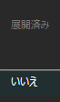
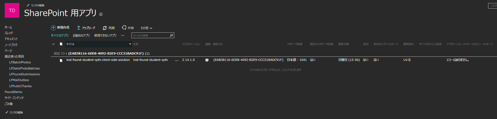

# 落とし物システム（SharePoint・SPFx版）進捗と大学側への追加確認のお願い

# 1. 前回以降に確認できたこと

学生向け画面をSharePoint上で公開するには、次の3段階が必要となる。

1. **アップロード**：作成した `.sppkg` ファイルをカタログへ置く
2. **展開（デプロイ）**：アップロードしたアプリをSharePointで使用できる状態にする
3. **ページに配置・発行**：学生向け画面の部品（Webパーツ）をページに追加・発行し、閲覧権限のある学生が使えるようにする

前回お願いした検証用アカウントのサイトコレクション管理者設定は、対象サイトで有効になっている。アプリカタログも閲覧でき、学生向け画面の最新パッケージをアップロードできた。

現在は1まで完了し、2の展開で止まっている。パッケージは「有効」「有効なアプリパッケージ」がともに「はい」、エラーなしである一方、「展開済み」は「**いいえ**」となっている。アップロード後の信頼・展開の確認画面や「展開」ボタンが表示されず、SharePointページへの常設が完了できない。



[上の画像の画面を開く：検証サイトのアプリカタログ](https://cloudkobeu.sharepoint.com/teams/t-dxsuisin-tesvd2/AppCatalog/Forms/AllItems.aspx)

# 2. アプリで変更・検証したこと

| 対象     | 変更・確認内容                                                                                                                                           |
| -------- | -------------------------------------------------------------------------------------------------------------------------------------------------------- |
| 登録方法 | 職員による品物ごとの個別登録と、一般品をまとめて撮影する写真掲載に整理した。          |
| 不要機能 | 学生による拾得物登録、「ありがとう」・お礼メール、公開状態の選択、職員による手動マッチングを削除した。連絡先が分かる品物は窓口から直接連絡する扱いとした |

# 3. 現在止まっていること

対象サイトのアプリカタログについて、次の状態を確認した。

- 大学全体のカタログの管理一覧に、対象サイトの登録行が存在する
- パッケージのアップロード・検証はできるが、展開操作が表示されない


カタログの登録・ライブラリ作成は進んでいるものの、現在は展開機能を正常に利用できない。**有効化・構成時の権限不足などが考えられるが、当時の実行権限や失敗した処理は未確定**である。以前の有効化対応が行われていなかったという意味ではなく、構成結果の追加確認をお願いしたい。

# 4. 大学のSharePoint管理者の方にお願いしたいこと

対象サイト：[https://cloudkobeu.sharepoint.com/teams/t-dxsuisin-tesvd2](https://cloudkobeu.sharepoint.com/teams/t-dxsuisin-tesvd2)

検証用アカウント：`istc-dxsuiu37@cloudkobeu.onmicrosoft.com`

## 4.1 有効化に必要な権限とカタログの構成結果

`Add-SPOSiteCollectionAppCatalog` を実行する管理者本人のアカウントについて、次の3点を確認していただきたい。①は大学全体の管理者の役割、②・③はそれぞれ別のサイトに対する管理者権限である。[Microsoft公式の実行条件](https://learn.microsoft.com/en-us/powershell/module/microsoft.online.sharepoint.powershell/add-spositecollectionappcatalog?view=sharepoint-ps)

前回資料では、実行するアカウントに必要な権限条件の説明が不十分だった。今回は①・②・③すべての確認をお願いしたい。

### ① SharePoint管理者の役割

- **対象**：大学全体のSharePoint設定・サイト管理
- **確認方法**：[Microsoft 365管理センター](https://admin.microsoft.com) →「役割」→「役割の割り当て」→「SharePoint管理者」で、実行する本人が割り当て済みの一覧にいるか確認する

### ② 大学全体のアプリカタログのサイトコレクション管理者権限

- **対象**：[大学全体のアプリカタログ](https://cloudkobeu.sharepoint.com/sites/appcatalog)（`/sites/appcatalog`）
- **確認方法**：[SharePoint管理センター](https://cloudkobeu-admin.sharepoint.com) →「アクティブなサイト」→ `/sites/appcatalog` を選択 →「メンバーシップ」→「サイト管理者」で、実行する本人が登録されているか確認する

### ③ 検証サイトのサイトコレクション管理者権限

- **対象**：[今回の検証サイト](https://cloudkobeu.sharepoint.com/teams/t-dxsuisin-tesvd2)（`/teams/t-dxsuisin-tesvd2`）
- **確認方法**：[SharePoint管理センター](https://cloudkobeu-admin.sharepoint.com) →「アクティブなサイト」→ `/teams/t-dxsuisin-tesvd2` を選択 →「メンバーシップ」→「サイト管理者」で、実行する本人が登録されているか確認する

確認・追加するのは、**有効化を実行する大学側の管理者アカウント**である。

①が不足する場合は役割を割り当てられる管理者へ、②・③が不足する場合はSharePoint管理者へ、実行する本人への追加を依頼する。公式手順：[① 役割の確認・設定](https://learn.microsoft.com/en-us/microsoft-365/admin/add-users/assign-admin-roles?view=o365-worldwide)／[②・③ サイト管理者の確認・設定](https://learn.microsoft.com/en-us/sharepoint/manage-site-collection-administrators)。

権限の設定後、その管理者アカウントでカタログの有効化処理を改めて実行していただきたい。

今回の再構成案は、対象サイトのカタログを一度無効化し、再有効化する手順とする。

管理者のWindows PCで「SharePoint Online Management Shell」を開く。未インストールの場合は、[Microsoft公式ページ](https://www.microsoft.com/en-us/download/details.aspx?id=35588)からインストールする。

以下のコード全体を貼り付けて実行し、ブラウザが開いたら①・②・③の権限を持つ管理者アカウントでログインする。接続成功後に無効化・再有効化へ進み、エラーが発生した場合は後続のコマンドを実行せず中止する。

```powershell
try {
    Connect-SPOService -Url https://cloudkobeu-admin.sharepoint.com -UseSystemBrowser $true -ErrorAction Stop
    Remove-SPOSiteCollectionAppCatalog -Site https://cloudkobeu.sharepoint.com/teams/t-dxsuisin-tesvd2 -ErrorAction Stop
    Add-SPOSiteCollectionAppCatalog -Site https://cloudkobeu.sharepoint.com/teams/t-dxsuisin-tesvd2 -ErrorAction Stop
    Write-Host 'カタログの再有効化が完了しました。'
}
catch {
    Write-Error "処理を中止しました。詳細: $($_.Exception.Message)" -ErrorAction Continue
}
```

成功・失敗にかかわらず、PowerShellの実行結果を共有いただきたい。認証画面・パスワードの共有は不要。途中で失敗した場合、完了済みの操作は自動で元に戻らないため、実行結果を確認して次の対応を判断する。

`Remove-SPOSiteCollectionAppCatalog` はカタログ機能を無効化する操作であり、ライブラリを削除する操作ではない。この無効化・再有効化は、公式の管理コマンドを用いた復旧案である。[Microsoft公式の有効化・無効化手順](https://learn.microsoft.com/en-us/sharepoint/dev/general-development/site-collection-app-catalog)

再有効化後はこちらでパッケージを再アップロードし、「展開済み＝はい」とページへの追加を確認する。
